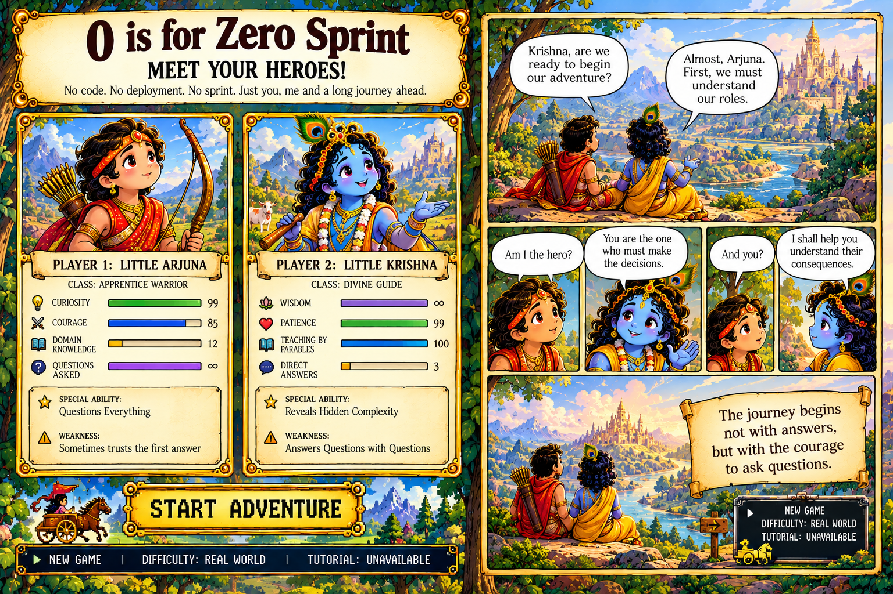
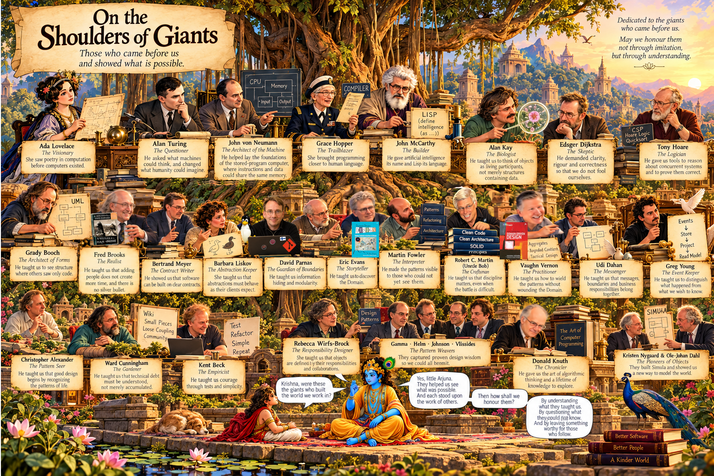

# 🎨 Code, Culture & Cosmos: An Illustrated Journey Through Software Engineering

Welcome to a visual exploration of software architecture, Domain-Driven Design (DDD), Agile principles, and timeless philosophy. Click on any topic below to expand and view the comic/infographic directly on the page!

---

## 🚀 Foundations & Introduction

<b>0-sprint-heroes.png</b> — Sprint Heroes & Team Dynamics

<b>00_intro_giants.png</b> — Standing on the Shoulders of Giants

---

## A

<b>A is AI -sleeping chariotee.png</b> — AI and the Sleeping Charioteer

<b>A is for Action in Inaction_ A Comic Lesson.png</b> — Action in Inaction

<b>A is for aggregate.png</b> — Aggregates in DDD

<b>A is for Agile Manifesto_ Values Over Rituals.png</b> — Agile Manifesto

<b>A is for AI.png</b> — Perspectives on Artificial Intelligence

<b>A is for Anti-Corruption Layer.png</b> — Anti-Corruption Layer (ACL)

<b>A Is for Apocalypse_ Shortcuts Unraveled.png</b> — Shortcuts Unraveled

<b>A is for architecture.png</b> — Architecture

---

## B

<b>B is for Bidirectional Mapping_ Model Relationships Explicitly.png</b> — Bidirectional Mapping

<b>B is for Big Ball of Mud_ A Software Architecture Comic.png</b> — Big Ball of Mud

<b>B is for Bounded Contexts_ Different Meanings, Clear Boundaries.png</b> — Bounded Contexts

<b>B is for boy_scout.png</b> — The Boy Scout Rule

<b>B is for Brainstorming_ From Ideas to Insight.png</b> — Brainstorming

<b>B is for Brooks’s Law_ The Chaotic Feast.png</b> — Brooks’s Law

---

## C

<b>C is for complexities.jpg</b> — Managing Complexities

<b>C Is for Cargo Cult.png</b> — Cargo Cult

<b>C is for Cohesion and Coupling Kingdoms.png</b> — Cohesion & Coupling

<b>C is for Conceptual Contours and Closure of Operations.png</b> — Conceptual Contours

<b>C is for Concurrency in the Kingdom_ Protecting Invariants.png</b> — Concurrency & Invariants

<b>C is for Context Map Infographic.png</b> — Context Maps

<b>C is for Conway’s Law_ Teams Shape Software.png</b> — Conway’s Law (Teams)

<b>C is for Conway’s Law_ Teams Shape Systems.png</b> — Conway’s Law (Systems)

<b>C is for Coupling_ The Microservices Divorce Comic.png</b> — The Microservices Divorce

<b>C Is for Curse_ Forgotten Knowledge.png</b> — Curse of Forgotten Knowledge

<b>C is for cyclomatic Complexity.png</b> — Cyclomatic Complexity

---

## D

<b>D is for DIP vs DI_ A Mythic Code Journey.png</b> — DIP vs DI

<b>D is for documentation Dokumentoinnin totuus ja tulkinta.png</b> — Documentation Truth & Interpretation

<b>D is for Dogma vs Dharma_ A Mahabharata Lesson.png</b> — Dogma vs Dharma

<b>D is for Domain Events_ A Comic Infographic Lesson.png</b> — Domain Events

<b>D Is for Domain_ A Storybook Journey.png</b> — Domain

<b>D is for DRY vs WET_ Domain Truths Illustrated.png</b> — DRY vs WET

---

## E

<b>E Is for Entity_ Identity in Action.png</b> — Entities

<b>E is for entropy.png</b> — Entropy

<b>E is for Essential Complexity-1.png</b> — Essential Complexity (Part 1)

<b>E is for Essential Complexity-2.png</b> — Essential Complexity (Part 2)

<b>E is for Event Storming oppitunti.png</b> — Event Storming

<b>E is for Eventual Consistency_ Messages in Motion.png</b> — Eventual Consistency

<b>E is for Explicit Concepts_ A Domain Modeling Journey.png</b> — Explicit Concepts

---

## F

<b>F Is for Factory_ Comic Guide to Valid Objects.png</b> — Factories

<b>F Is for Feature Envy_ A Marketplace Lesson.png</b> — Feature Envy

<b>F Is for Force_ Beyond Rigid Models (1).png</b> — Force

<b>F is for Functional Programming Meets Object Design.png</b> — FP Meets OOP

<b>F Is for Functional Programming.png</b> — Functional Programming

---

## 🇬 🇭 🇮

<b>G is for Glossary_ From Words to Understanding.png</b> — Glossary

<b>H is for Hexagonal Architecture_ A Comic Guide.png</b> — Hexagonal Architecture

<b>I for Iterative Process_ Building Better Bridges.png</b> — Iterative Process

<b>I is for Idempotency and Optimistic Locking.png</b> — Idempotency & Optimistic Locking

<b>I is for identity_invariant.jpg</b> — Identity & Invariants

<b>I is for Inaction in Action_ A Developer’s Lesson.png</b> — Inaction in Action

<b>I is for inheritance.png</b> — Inheritance (Part 1)

<b>I is for inheritance2.png</b> — Inheritance (Part 2)

<b>I is for Invariant.png</b> — Invariants

<b>I Is for Invariant_ Domain Rules Illustrated.png</b> — Domain Rules

---

## 🇯 🇰 🇱

<b>J is for Jargon Bazaar_ Words and Meaning.png</b> — Jargon Bazaar

<b>J Is for Java_ Code and Coffee.png</b> — Java & Coffee

<b>K is for Karma and Technical Debt_ A Comic Lesson-2.png</b> — Karma & Technical Debt

<b>K is for Knowledge Crunching.png</b> — Knowledge Crunching

<b>K is for Krishna’s Promise_ Restoring Architectural Dharma.png</b> — Architectural Dharma

<b>L is for Law of Demeter and Long-Running Processes.png</b> — Law of Demeter

<b>L is for Loyalty_ Gratitude and Judgment.png</b> — Loyalty & Judgment

---

## 🇲 🇳 🇴

<b>M is for Meditation Amid the Notifications.png</b> — Mindfulness

<b>M is for Models and Messages Illustrated.png</b> — Models & Messages

<b>M is for Murphy’s Law_ The Cost of Ignoring Failure.png</b> — Murphy’s Law

<b>M is for Māyā ja varjojen takainen todellisuus.png</b> — Māyā & Reality

<b>N is for naming.jpg</b> — Naming

<b>N is for Nishkama Karma_ Coding Without Attachment.png</b> — Nishkama Karma

<b>N Is for Nothingness_ Calm Architecture.png</b> — Calm Architecture

<b>O is for Objects in Action_ OOP and Design.png</b> — OOP & Design

<b>O is for outbox pattern.png</b> — Outbox Pattern

---

## 🇵 🇶 🇷

<b>P is for persistence1.png</b> — Persistence (Part 1)

<b>P is for persistence2.png</b> — Persistence (Part 2)

<b>P is for primitive_obsession.png</b> — Primitive Obsession

<b>P is for product owner.jpg</b> — Product Owner

<b>P is for Project Pathologies_ Epic Lessons.png</b> — Project Pathologies

<b>Q is for Query Separation_ Ask, Don’t Load.png</b> — Query Separation (CQRS)

<b>Q is for query_and_question.jpg</b> — Queries & Questions

<b>R is for Rehydraationin tarina kolmessa paneelissa.png</b> — Rehydration

<b>R is for repository.jpg</b> — Repository Pattern

<b>R is for Retention comic page (1).png</b> — Retention

---

## 🇸 🇹 🇺

<b>S is for Sagan koreografia ja orkestrointi.png</b> — Saga Choreography & Orchestration

<b>S is for samsara.png</b> — Samsara

<b>S is for Service, SRP, and Subdomains Comic Spread.png</b> — Service, SRP & Subdomains

<b>S is for Shared Kernel_ A Product Model Adventure.png</b> — Shared Kernel

<b>S is for Specification and Policy_ Epic DDD Guide.png</b> — Specification & Policy

<b>S is for Svadharma_ yksi vastuu, yksi syy muuttua.png</b> — Svadharma (SRP)

<b>T is for Krishna Reveals the Flow of Time.png</b> — Flow of Time

<b>T is for Task-Based UI_ A Comic Infographic.png</b> — Task-Based UI

<b>T is for TDD1.png</b> — TDD (Part 1)

<b>T is for TDD2.png</b> — TDD (Part 2)

<b>T is for Tell, Don’t Ask_ Aggregate Wisdom.png</b> — Tell, Don't Ask

<b>T is for Transactional Design.png</b> — Transactional Design

<b>U is for Ubiquitous Language_ The Golden Thread.png</b> — Ubiquitous Language

<b>U is for unit-testing.png</b> — Unit Testing

---

## 🇻 🇼 🇽 🇾 🇿

<b>V is for Validation vs Invariants Infographic.png</b> — Validation vs Invariants

<b>V Is for Void_ Beyond Patterns.png</b> — Beyond Patterns

<b>V is Value Objects_ Pearls of Meaning.png</b> — Value Objects

<b>W is From Waterfall to Learning River.png</b> — Waterfall to Learning River

<b>X is for XP Mountain_ A Comic Guide to Extreme Programming.png</b> — XP Mountain

<b>Y is for YAGNI_ Build Only What You Need.png</b> — YAGNI

<b>Z is for Zero Assumptions, Endless Learning.png</b> — Zero Assumptions

<b>Z is for_Zeal_ A Curious Path to Wisdom.png</b> — Zeal & Wisdom

---

## 💡PARENTAL GUIDANCE
This book contains advanced concepts such as domain modeling, hidden invariants, tight coupling, and architectural responsibility.
Children aged 4–10 may read independently.
Adults must be accompanied by a child capable of asking “But WHY?” at least seventeen times.
Software architects are strongly advised to leave their egos at the door.
Warning: Exposure may cause spontaneous refactoring.
